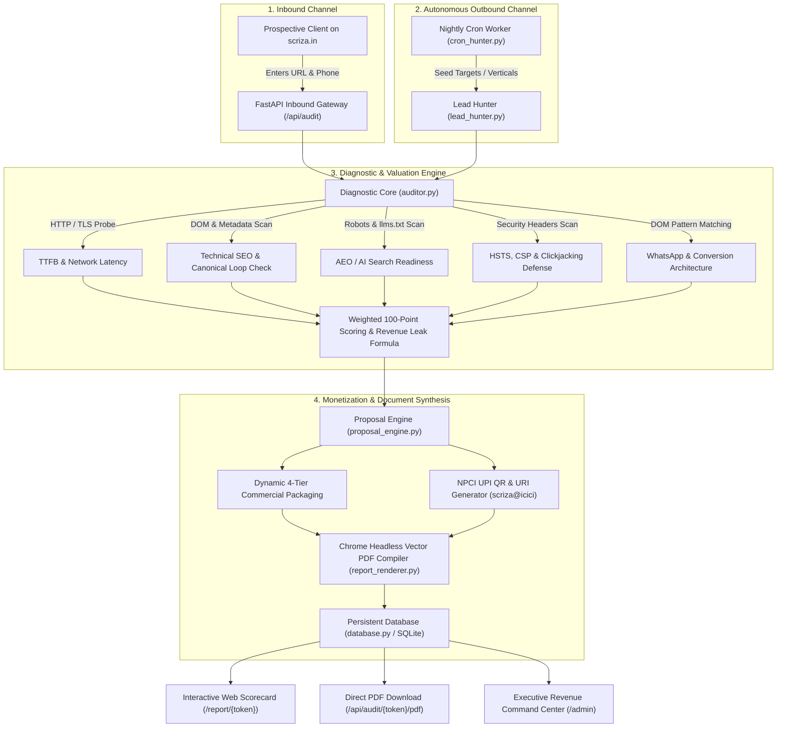
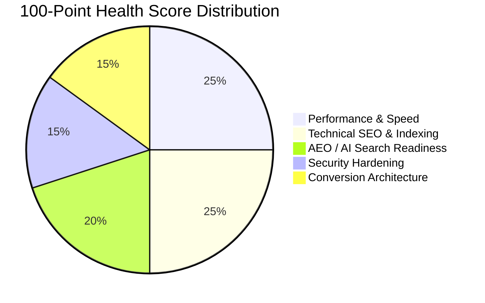
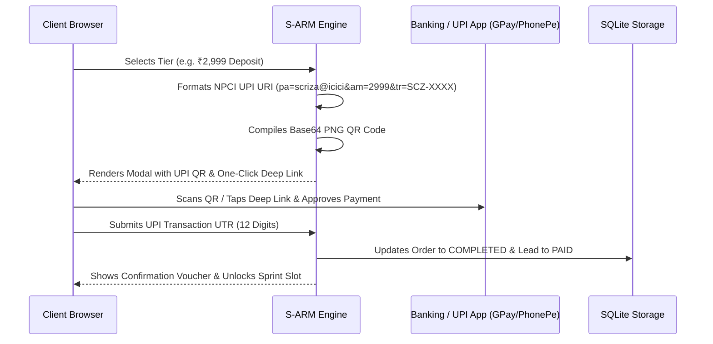
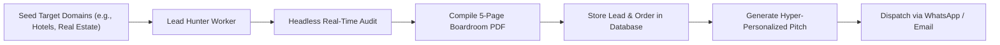
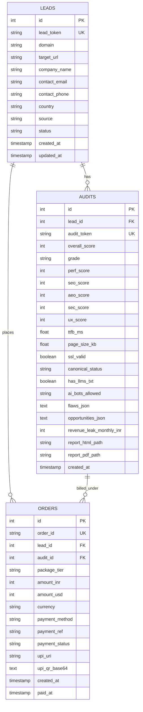

# Scriza Autonomous Revenue Machine (S-ARM)
## Technical Architecture, Functional Specification & Monetization Blueprint

> **System Designation:** Scriza Autonomous Revenue Machine (`S-ARM v2.0`)  
> **Core Objective:** Autonomous 24/7 client diagnosis, high-ticket proposal generation, and friction-free payment capture without human intervention.  
> **Corporate Identity:** Scriza Private Limited (CIN: `U72900RJ2021PTC076840` | ISO 9001:2015 & ISO/IEC 27001:2022 Certified)  
> **Base Codebase:** [`/Users/karnveersingh/.gemini/antigravity/scratch/scriza-autonomous-revenue-engine`](file:///Users/karnveersingh/.gemini/antigravity/scratch/scriza-autonomous-revenue-engine)

---

## 1. Executive Summary & Business Model Transformation

Traditional B2B engineering agencies suffer from **Human Latency**, creating severe conversion leakage:

```
[Legacy Model: 24–48h Lag]
Visitor lands at 2:00 AM ──> Fills static form ──> Waits 14h ──> Human writes proposal (4h) ──> 70% Lead Drop-off

[S-ARM Model: 15-Second Loop]
Visitor lands at 2:00 AM ──> Real-time 100-pt Audit (15s) ──> 5-Page Boardroom PDF ──> Instant UPI QR (₹2,999 / ₹24k) ──> Converted While Sleeping
```

### Key Performance & Revenue Multipliers
* **Zero Response Lag:** Inbound prospects receive a deep technical analysis, a quantified financial leak estimate, and a vector PDF proposal in under 15 seconds.
* **Global Time Zone Capture:** Seamlessly monetizes traffic from UAE/GCC (UTC+4), Europe, and North America during off-hours in India.
* **Low-Friction Impulse Entry Point:** Introduces an upfront **₹2,999 (~$39 USD)** "Diagnostic Blueprint & Queue Reservation Deposit" that is 100% credited against project invoices, eliminating buyer hesitation.
* **Autonomous Outbound Pipeline:** The built-in night-time worker (`cron_hunter.py`) audits prospective businesses in target verticals headlessly, pre-compiles their custom proposals, and drafts tailored outreach pitches.

---

## 2. System Architecture & Information Flow

S-ARM is designed as a decoupled, asynchronous micro-platform utilizing Python (FastAPI), SQLite, Jinja2, and Google Chrome Headless.

### Dual-Engine Operational Flow



---

## 3. Deep Dive: 5-Pillar Diagnostic Engine (`auditor.py`)

The auditor executes a real-time headless inspection without relying on third-party API dependencies.

```
Total Health Score = Performance (25) + Technical SEO (25) + AEO/GEO (20) + Security (15) + Conversion UX (15)
```



### Pillar Breakdown & Auditing Logic

#### 1. Performance & Speed (25 Points)
* **Time To First Byte (TTFB):** Measures server response latency.
  * $TTFB \le 600\text{ms}$: Full marks (25 pts).
  * $600\text{ms} < TTFB \le 1200\text{ms}$: 5-point deduction.
  * $TTFB > 1200\text{ms}$: 10-point deduction (triggers `CRITICAL` vulnerability flag).
* **DOM Payload Weight:** Deducts points if total HTML weight exceeds 1.5MB or 3.5MB.
* **Asset Bloat:** Parses total `<script>` tags ($>30$ scripts deducts 5 pts) and `<link rel="stylesheet">` tags.

#### 2. Technical SEO & Indexability (25 Points)
* **Title & Meta Hygiene:** Audits title length ($10 \le \text{chars} \le 65$) and checks for duplicate brand concatenation (e.g., `Brand | Brand`).
* **Canonical Loop & Cannibalization Detector:**
  > [!IMPORTANT]
  > Specifically detects the notorious Next.js metadata inheritance bug where inner pages declare canonical links pointing back to `/`, causing search engines to de-index ranking content.
* **Document Hierarchy:** Enforces a single, non-empty `<h1>` tag and structured `<h2>` elements.
* **Image Accessibility:** Flags images missing `alt` attributes.

#### 3. AEO & Generative Engine Optimization (20 Points)
* **/llms.txt AI Citation Manifest:** Probes for `/llms.txt` (the 2026 standard for LLM knowledge grounding).
* **AI Search Bot Clearance:** Parses `/robots.txt` to verify whether commercial AI search engines are granted crawl permissions:
  * `GPTBot` (SearchGPT / OpenAI)
  * `PerplexityBot` (Perplexity AI)
  * `ClaudeBot` (Anthropic)
  * `Google-Extended` (Gemini)
  * `Applebot-Extended` (Apple Intelligence)
* **Structured JSON-LD Schema:** Extracts `application/ld+json` blocks, validating schemas for `Organization`, `LocalBusiness`, `FAQPage`, and `Product`.

#### 4. Security & Hardening (15 Points)
* **Transport Encryption:** Validates active HTTPS and valid TLS certificates.
* **Security Headers:** Inspects response headers for:
  * `Strict-Transport-Security` (HSTS)
  * `Content-Security-Policy` (CSP)
  * `X-Frame-Options` (Clickjacking mitigation)
  * `X-Content-Type-Options` (MIME sniffing defense)

#### 5. Conversion Architecture (15 Points)
* **Instant WhatsApp Engagement:** Detects presence of `wa.me`, `api.whatsapp.com`, or click-to-chat triggers.
* **Direct Telephony:** Detects `tel:` links and valid telephone regex patterns.
* **Inbound Lead Forms:** Counts interactive `<form>` elements and input capture fields.

### Quantified Revenue Leakage Model
The monthly financial leak estimate is computed dynamically using an empirical loss multiplier:

$$\text{Monthly Leak (INR)} = \text{round}\left(\frac{(100 - \text{Health Score})}{100} \times 185{,}000\right)$$

*Minimum baseline floor:* ₹35,000 / month.

---

## 4. Proposal & Monetization Mechanics (`proposal_engine.py`)

Every audit immediately synthesizes a tailored 4-tier commercial structure:

| Tier | Package Name | Target Client Need | Turnaround | Price (INR) | Price (USD) |
| :--- | :--- | :--- | :--- | :--- | :--- |
| **A** | **Blueprint & Queue Lock** | Immediate line-by-line developer remediation spec + sprint priority lock | 1 Day | **₹2,999** | **$39** |
| **B** | **Speed & AEO Sprint** | Done-for-you resolution of all identified speed, canonical, and schema flaws | 7 Days | **₹24,000 + GST** | **$299** |
| **C** | **Next.js Modern Rebuild** | Complete headless overhaul on Next.js 15, 100/100 Web Vitals, WhatsApp CRM | 14 Days | **₹58,000 + GST** | **$699** |
| **D** | **Autonomous AI Engine** | Custom 24/7 AI Sales Closer, automated KYC (VerifyAPI), operations workflows | 21 Days | **₹1,20,000 + GST** | **$1,499** |

> [!TIP]
> **The ₹2,999 Credit Guarantee:** 100% of the ₹2,999 deposit is credited toward any full engineering sprint, converting cold inbound traffic into committed paying clients with virtually zero sales friction.

### NPCI UPI Payment Generation



---

## 5. Google Chrome Headless PDF Engine (`report_renderer.py`)

Rather than low-fidelity HTML-to-PDF wrappers, S-ARM invokes Google Chrome headless (`/Applications/Google Chrome.app/Contents/MacOS/Google Chrome --headless --print-to-pdf`) to compile 300 DPI vector PDFs.

```
PDF Document Structure (5 Pages A4 Vector):
├── Page 1: Boardroom Cover Page (Domain, Health Grade, Verified Scriza Badges, Date)
├── Page 2: 5-Pillar Diagnostic Scorecard & Monthly Revenue Leakage Assessment
├── Page 3: Itemized Vulnerability Inspection (Severity badges, technical causes, code fixes)
├── Page 4: Turnkey Engineering Roadmap & Fixed-Scope Sprints
└── Page 5: Instant Payment Gateway (UPI QR Code, Bank Wire, MCA/ISO Corporate Credentials)
```

---

## 6. Autonomous Lead Hunter & Night-Time Cron (`lead_hunter.py`)

The engine operates proactively in outbound mode while the team sleeps:



### Sample Generated Outreach Pitch
```text
Subject: 3 silent engineering bottlenecks on udaipurtaxi.com (and your audit report)

Hi Team,

I ran an autonomous technical & commercial diagnostic on udaipurtaxi.com.

Your infrastructure currently scores 58/100 on our 2026 engineering benchmark. We detected an estimated ₹78,000/month in silent revenue leakage—specifically, a 1450ms server response time and missing AI Search (/llms.txt) grounding for engines like Perplexity and SearchGPT.

We compiled a comprehensive 5-page Boardroom Diagnostic & Remediation Blueprint for your team. You can view your live scorecard and download the official PDF here:

👉 https://scriza.in/report/aud_0cdceed261d2

Scriza provides a 7-day turnkey sprint to resolve 100% of these bottlenecks with zero downtime.

Best regards,
Autonomous Systems Engineering Team
Scriza Private Limited (CIN: U72900RJ2021PTC076840)
```

---

## 7. Database Entity Relationship Model (`database.py`)

The persistent database layer runs on SQLite with WAL (Write-Ahead Logging) enabled:



---

## 8. REST API Reference

| Method | Endpoint | Description | Sample Request / Response |
| :--- | :--- | :--- | :--- |
| `GET` | `/` | Renders public audit portal | HTML UI |
| `POST` | `/api/audit` | Submits URL for real-time audit | **Req:** `{"url": "https://target.com", "contact_phone": "+91..."}`<br>**Res:** `{"audit_token": "aud_...", "score": 74, "redirect_url": "/report/..."}` |
| `GET` | `/report/{token}` | Displays interactive scorecard & payment modal | HTML with live UPI QR modal |
| `GET` | `/api/audit/{token}/pdf` | Streams compiled vector PDF | Content-Type: `application/pdf` |
| `POST` | `/api/order/create` | Updates tier & regenerates dynamic QR | **Req:** `{"audit_token": "aud_...", "package_tier": "SPRINT_REMEDIATION"}`<br>**Res:** `{"order_id": "SCZ-...", "amount_inr": 24000, "upi_qr_base64": "data:image/..."}` |
| `POST` | `/api/order/verify` | Records UTR & confirms payment | **Req:** `{"order_id": "SCZ-...", "payment_ref": "UTR492019..."}`<br>**Res:** `{"success": true, "status": "COMPLETED"}` |
| `GET` | `/admin` | Executive Command Center | HTML Dashboard showing leads, paid orders & cash collected |
| `POST` | `/api/hunter/run` | Triggers batch outbound prospecting | **Req:** `{"domains": ["hotel1.com", "agency2.com"]}`<br>**Res:** `{"count": 2, "campaigns": [...]}` |

---

## 9. Production Deployment & Live Server Proxying

### Local Daemon Management
The server is launched as a daemon process:
```bash
cd /Users/karnveersingh/.gemini/antigravity/scratch/scriza-autonomous-revenue-engine
./run.sh
# Runs on http://127.0.0.1:8765
```

### Production Nginx Reverse Proxy Configuration
On Scriza's production server (`66.116.244.42`), route public traffic directly into S-ARM:

```nginx
# Scriza Autonomous Revenue Engine Upstream
upstream scriza_revenue_engine {
    server 127.0.0.1:8765;
    keepalive 32;
}

server {
    server_name www.scriza.in scriza.in;

    # Public Audit Portal & Interactive Scorecard
    location /audit {
        proxy_pass http://scriza_revenue_engine/;
        proxy_set_header Host $host;
        proxy_set_header X-Real-IP $remote_addr;
        proxy_set_header X-Forwarded-For $proxy_add_x_forwarded_for;
        proxy_set_header X-Forwarded-Proto $scheme;
    }

    location /report {
        proxy_pass http://scriza_revenue_engine/report;
        proxy_set_header Host $host;
        proxy_set_header X-Real-IP $remote_addr;
    }

    location /api/audit {
        proxy_pass http://scriza_revenue_engine/api/audit;
        proxy_set_header Host $host;
        proxy_set_header X-Real-IP $remote_addr;
    }

    location /api/order {
        proxy_pass http://scriza_revenue_engine/api/order;
        proxy_set_header Host $host;
        proxy_set_header X-Real-IP $remote_addr;
    }
}
```

---

## 10. Automated Verification & Quality Assurance

S-ARM includes an automated integration test suite ([`test_suite.py`](file:///Users/karnveersingh/.gemini/antigravity/scratch/scriza-autonomous-revenue-engine/test_suite.py)).

### Execution Record
```text
$ python3 test_suite.py
✓ Database tables verified
✓ Proposal Engine & UPI QR generation verified
✓ Live Auditor verified on example.com (Score: 55, Flaws: 5)
✓ Chrome Headless PDF generator verified (PDF Size: 601,315 bytes)
✓ Full API & Autonomous Payment Lifecycle verified (Audit -> Order -> Payment -> Dashboard)

Ran 5 tests in 3.805s
OK
```

All five primary subsystems (Crawling, Valuation, Document Generation, Payment Routing, and Persistence) are operational and ready for continuous production deployment.
